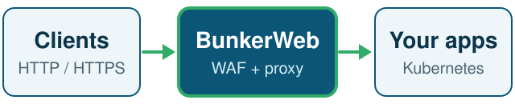
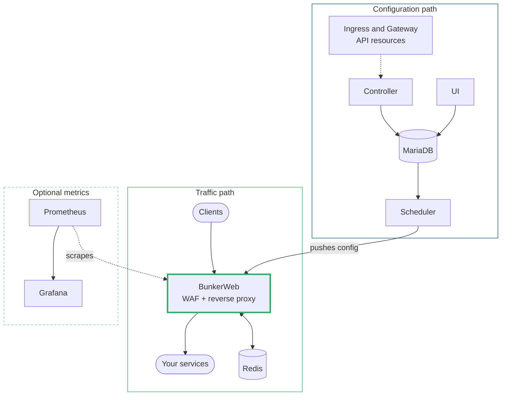
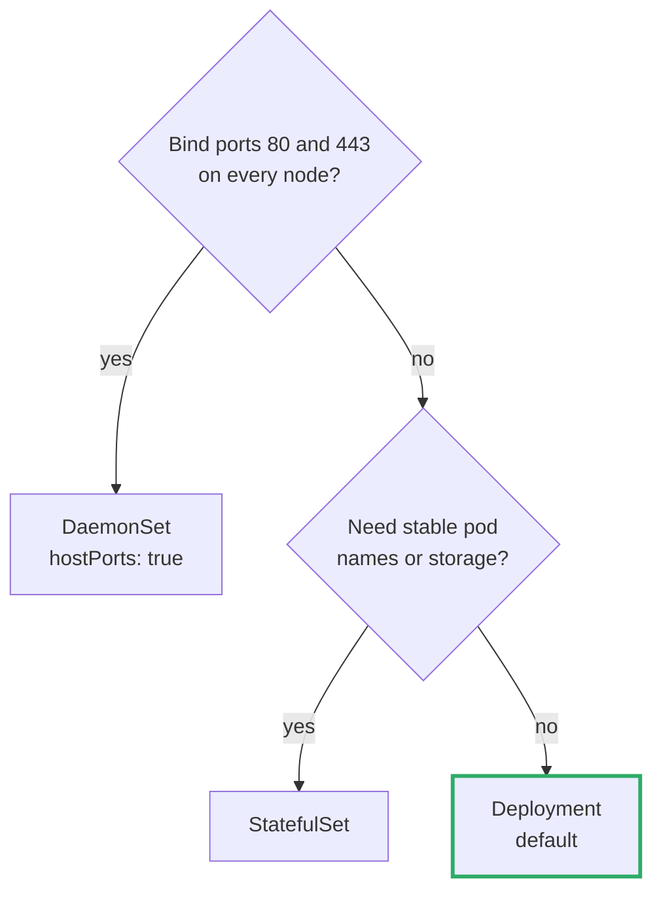

<p align="center">
  <picture>
    <source media="(prefers-color-scheme: dark)" srcset=".github/assets/logo-white.png">
    
  </picture>
</p>

<h1 align="center">Helm chart for Kubernetes</h1>

<p align="center">
  Run the <a href="https://www.bunkerweb.io/?utm_campaign=self&amp;utm_source=github">BunkerWeb</a> web application firewall and reverse proxy on Kubernetes.<br>
  One release deploys the proxy, scheduler, controller, web UI and their database.
</p>

<p align="center">
  <a href="charts/bunkerweb/Chart.yaml"></a>
  <a href="charts/bunkerweb/Chart.yaml"></a>
  <a href="LICENSE"></a>
  <a href="https://score.getplumber.io/github.com/bunkerity/bunkerweb-helm"></a>
</p>

<p align="center">
  <a href="#install"><b>Install</b></a> ·
  <a href="#choose-your-deployment">Deployment</a> ·
  <a href="#production-checklist">Production</a> ·
  <a href="#examples-index">Examples</a> ·
  <a href="#day-2-upgrade-troubleshoot-uninstall">Day 2</a> ·
  <a href="https://docs.bunkerweb.io/latest/integrations/?utm_campaign=self&amp;utm_source=bunkerwebio#kubernetes">BunkerWeb docs</a> ·
  <a href="#support">Support</a>
</p>

<p align="center">
  <picture>
    <source media="(prefers-color-scheme: dark)" srcset=".github/assets/traffic-dark.svg">
    
  </picture>
</p>

| I want to | Go to |
|-----------|-------|
| Try it on a cluster | [Install](#install) |
| See how the parts connect | [How it fits together](#how-it-fits-together) |
| Pick a workload kind or controller | [Choose your deployment](#choose-your-deployment) |
| Harden a production install | [Production checklist](#production-checklist) |
| Start from a values file | [Examples index](#examples-index) |
| Upgrade or remove a release | [Day 2](#day-2-upgrade-troubleshoot-uninstall) |

## Install

> [!IMPORTANT]
> Read the [BunkerWeb Kubernetes integration docs](https://docs.bunkerweb.io/latest/integrations/?utm_campaign=self&utm_source=bunkerwebio#kubernetes) first. This chart packages that integration.

**You need** Kubernetes 1.21+ (1.23+ with `bunkerweb.hpa.enabled`), Helm 3 and a PersistentVolume provisioner. Gateway API support also needs the [Gateway API CRDs](https://gateway-api.sigs.k8s.io/guides/getting-started/#installing-gateway-api).

```bash
helm repo add bunkerweb https://repo.bunkerweb.io/charts
helm repo update
helm install mybunkerweb bunkerweb/bunkerweb -n bunkerweb --create-namespace
```

Default values deploy BunkerWeb, the scheduler, the controller, the UI, MariaDB and Redis. Reach the UI with a port-forward and open <http://localhost:7000>:

```bash
kubectl port-forward svc/ui-mybunkerweb 7000:7000 -n bunkerweb
```

Publish an app by creating an `Ingress` with `ingressClassName: bunkerweb`. The chart creates that IngressClass, and the `mybunkerweb-external` service carries the traffic.

## How it fits together



Dotted lines mark watched resources and optional metrics scraping. MariaDB and Redis can also run outside the chart.

## Choose your deployment

### BunkerWeb workload kind



| Kind (`bunkerweb.kind`) | Pick it when | Settings that matter |
|-------------------------|--------------|----------------------|
| `Deployment` (default) | You scale behind a Service and want rolling updates | `replicas`, `hpa`, `pdb` |
| `DaemonSet` | One pod per node, bound to the node's ports 80 and 443 | `hostPorts`, `updateStrategy`, `minReadySeconds` |
| `StatefulSet` | You need stable pod names or storage. Rare for ingress. | `replicas` |

> [!NOTE]
> The HPA targets a `Deployment` unless you set `bunkerweb.hpa.targetKind`. `hostPorts` only applies to a `DaemonSet`, and `replicas` is ignored by it. The PodDisruptionBudget renders only when `bunkerweb.replicas` is above 1, on any kind.

### Controller

The controller runs as either a `GatewayController` or an `IngressController`, never both. `gatewayClass.enabled: true` selects the `GatewayController`.

| | Ingress (default) | Gateway API (experimental) |
|--|-------------------|----------------------------|
| Resources watched | `Ingress` | Gateway API resources |
| Switch | Default, keep `gatewayClass.enabled: false` | `gatewayClass.enabled: true` |
| Prerequisite | None | [Gateway API CRDs](https://gateway-api.sigs.k8s.io/guides/getting-started/#installing-gateway-api) |

### Database, cache and optional parts

| Part | Bundled | Use your own |
|------|---------|--------------|
| MariaDB | On | `mariadb.enabled: false` and `settings.misc.databaseUri`. See [`minimal.yaml`](examples/minimal.yaml). |
| Redis | On | `redis.enabled: false` and `settings.redis.redisHost`. For Sentinel see [`redis-sentinel.yaml`](examples/redis-sentinel.yaml). |
| Scheduler | On | `scheduler.enabled: false` when another release or cluster runs the scheduler |
| API | Off | `api.enabled: true`, with authentication configured |
| MCP | Off | `mcp.enabled: true`. See the warning below. |
| Prometheus, Grafana | Off | `prometheus.enabled`, `grafana.enabled`. Advanced metrics need BunkerWeb PRO. |

Grafana provisions a BunkerWeb dashboard for requests, attacks and instance health (requires the BunkerWeb PRO Prometheus exporter), plus a Kubernetes logs dashboard (requires a Loki datasource receiving your logs).

> [!WARNING]
> The MCP server has no built-in authentication on `/mcp`. Restrict access with IP whitelisting or network policies before you expose it.

## Production checklist

- [ ] Use [external MariaDB and Redis](examples/minimal.yaml) instead of the bundled ones.
- [ ] Keep credentials in one Secret and set `settings.existingSecret` ([`bunkerweb-secret.yaml`](examples/bunkerweb-secret.yaml)).
- [ ] Set your own UI and database passwords.
- [ ] Run two or more BunkerWeb replicas with `bunkerweb.hpa` and `bunkerweb.pdb` ([`high-availability.yaml`](examples/high-availability.yaml)).
- [ ] Set CPU and memory requests and limits on every component.
- [ ] Turn on `networkPolicy.enabled`. Your CNI must enforce NetworkPolicies.
- [ ] Review the pod security contexts.
- [ ] Whitelist trusted IPs before you expose the MCP server.
- [ ] Pick the Service type for your cluster: `LoadBalancer` (default), `NodePort` or `ClusterIP`.

## Examples index

Each file lists only the values that differ from the chart defaults. Every file is in [`examples/`](examples/), and [`docs/values.md`](docs/values.md) documents all keys.

| Scenario | File | Command |
|----------|------|---------|
| Production-like, external MariaDB and Redis | [`minimal.yaml`](examples/minimal.yaml) | `helm install bunkerweb bunkerweb/bunkerweb -f examples/minimal.yaml` |
| High availability: replicas, HPA, PDB, topology spread | [`high-availability.yaml`](examples/high-availability.yaml) | `helm install bunkerweb bunkerweb/bunkerweb -f examples/high-availability.yaml` |
| Full test stack with Grafana and Prometheus (PRO) | [`all-in-one.yaml`](examples/all-in-one.yaml) | `helm install bunkerweb-aio bunkerweb/bunkerweb -f examples/all-in-one.yaml` |
| External Redis Sentinel | [`redis-sentinel.yaml`](examples/redis-sentinel.yaml) | `-f examples/redis-sentinel.yaml` |
| Credentials in a Secret | [`bunkerweb-secret.yaml`](examples/bunkerweb-secret.yaml) | `kubectl apply -f examples/bunkerweb-secret.yaml` |
| MCP server for AI assistants | [`mcp-integration.yaml`](examples/mcp-integration.yaml) | `helm install bunkerweb bunkerweb/bunkerweb -f examples/mcp-integration.yaml` |
| Logs in the UI | [`logging.yaml`](examples/logging.yaml) | `-f examples/logging.yaml` |
| Ship logs with Vector | [`logging-services-with-vector.yaml`](examples/logging-services-with-vector.yaml) | Values for the Vector chart |
| Custom plugins | [`plugins.yaml`](examples/plugins.yaml) | `-f examples/plugins.yaml` |

## Day 2: upgrade, troubleshoot, uninstall

### Upgrade

```bash
helm repo update bunkerweb
helm search repo bunkerweb/bunkerweb --versions
helm upgrade mybunkerweb bunkerweb/bunkerweb -n bunkerweb -f myvalues.yaml
```

Read [`CHANGELOG.md`](CHANGELOG.md) before each upgrade.

> [!WARNING]
> **Charts after 1.0.24.** With `settings.existingSecret` set, the BunkerWeb PRO license comes from the secret's `pro-license-key` key, and a plain `scheduler.proLicenseKey` is ignored. The optional feature secrets follow the same rule: `zerossl-api-key`, `custom-ssl-key`, `sessions-secret`, `auth-basic-password`, `darkvisitors-token` and `crowdsec-api-key`.
>
> The secret wins over the matching plaintext values (`scheduler.features.sessions.sessionsSecret`, `scheduler.features.authBasic.authBasicPassword` and so on). If you combine `settings.existingSecret` with plaintext feature values, the plaintext is now ignored. Add the matching keys to your secret, or the feature loses its credential without an error.

<details>
<summary><b>Troubleshooting</b></summary>

| Symptom | Check |
|---------|-------|
| BunkerWeb pods do not start | `kubectl logs -l bunkerweb.io/component=bunkerweb -n bunkerweb` |
| Database connection errors | `kubectl describe pod -l bunkerweb.io/component=mariadb -n bunkerweb` |
| Ingress has no effect | `kubectl get ingress -n bunkerweb`, then `kubectl describe ingressclass bunkerweb` |
| Pod stuck in `Pending` | `kubectl get pvc -n bunkerweb`. The bundled databases need a PersistentVolume provisioner. |

BunkerWeb, the controller and the UI define liveness and readiness probes. Kubernetes restarts them on failure and sends traffic only to ready pods.

</details>

<details>
<summary><b>Uninstall</b></summary>

```bash
helm uninstall mybunkerweb -n bunkerweb

# Optional: remove the namespace
kubectl delete namespace bunkerweb
```

> [!WARNING]
> Back up the database and any other data before uninstalling. Helm deletes the chart-managed PVCs for MariaDB, Redis, UI logs, Prometheus and Grafana when present. Whether the underlying data survives depends on the StorageClass `reclaimPolicy`.

</details>

## Support

[Documentation](https://docs.bunkerweb.io/) · [Issues](https://github.com/bunkerity/bunkerweb/issues) · [Community forum](https://github.com/bunkerity/bunkerweb/discussions)

Licensed under [AGPL-3.0](LICENSE), the same terms as BunkerWeb.
